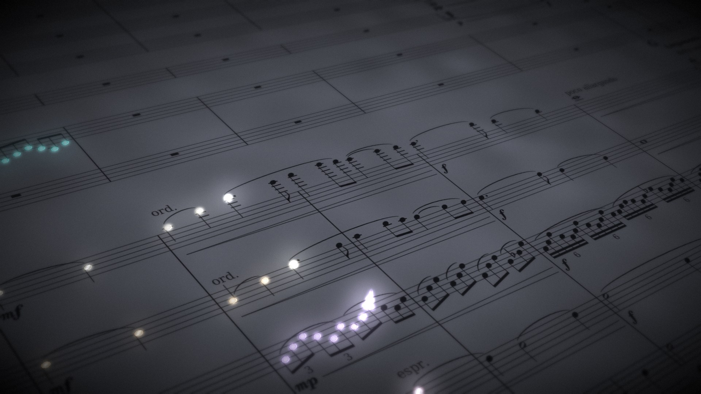

# Glowing-score videos (all four movements)

A video style made in October 2026 for movement II to match a screen recording Dan shared (the look of animated-score channels on YouTube), now made for every movement. The whole movement is engraved on one long line and shown as a dark sheet seen at an angle by a slowly moving camera. Each note lights up in its part's colour while it sounds, and a light for each part jumps through the air from note to note. The audio is each movement's final REAPER mockup.



## Rebuild

```
apt-get install -y lilypond ffmpeg      # LilyPond 2.24
pip install numpy pillow opencv-python-headless cairosvg
symphony/video/glow/make-glow-video.sh mvt1 path/to/mvt1-mockup-c63.mp3                  # whole movement
symphony/video/glow/make-glow-video.sh mvt2 path/to/mvt2-mockup-c57.mp3 --bars 53 64      # excerpt
symphony/video/glow/make-glow-video.sh finale path/to/mvt3-mockup-c30.mp3 --still 212     # test frames (score seconds), no MP4
```

| Movement | Score (main) | Mockup audio | Tempo map, stem loudness | Head |
|---|---|---|---|---|
| `mvt1` | `symphony/mvt1/v621` | `mvt1-mockup-c63.mp3` | `data/mvt1-c63-*` | 0 |
| `mvt2` | `symphony/mvt2/v600` | `mvt2-mockup-c57.mp3` | `data/mvt2-c57-*` | 0 |
| `scherzo` | `symphony/scherzo/v600` | `scherzo-mockup-c30.mp3` | `data/scherzo-c30-*` | 0 |
| `finale` | `symphony/mvt3/v600` | `mvt3-mockup-c30.mp3` | `data/finale-c30-*` | 0.30 s |

The mp3s are not in the repo (they are in the project's shared folder and in the local REAPER work folders on the Mac, `symphony/<mvt>/reaper-v6xx/cycles/cNN/`). The first run engraves the strip into `build/<movement>/` (1 to 5 minutes); later runs reuse it, so delete that folder after changing the score or the tools. The MP4 goes to `<movement>-glow-video.mp4` here (or `OUT=`) and is not committed. A whole movement takes 20 to 35 minutes on 4 cores (`JOBS=` parallel parts, default all cores).

`data/` holds what the video needs from the local mockup work folders, which are not committed:
- `<mvt>-<cycle>-tempo.json`: the `tempo` list of that cycle's `parts.json` (`[qn, bpm]` steps, the tempo map REAPER played) and `head_s`, the audio before score qn 0 in the delivered mp3 (the finale keeps 0.30 s of pre-roll since its c23; the others start at qn 0). Checked against the audio: the onsets of all four land within 0.02 s of the map.
- `<mvt>-<cycle>-stems.npz`: the loudness of every stem of that render in 50 ms frames (`db`, one row per stem in `names`), for the camera.

## How it works

1. **`tools/build-strip.sh`** copies the version's sources and runs **`tools/make_strip_ly.py`**, which edits `score.ly` as text: titles and the front-matter bookpart go, staff size 18, `ly:one-line-breaking` so the whole movement is one system, `\RemoveEmptyStaves` removed so every staff stays, MIDI-only scores dropped, and SVG `output-attributes` added to the score's own `\layout`: noteheads get the score moment `data-m` and duration `data-d` in quarter notes, bar lines `data-m`, and a small engraver names each staff symbol after its staff (the unnamed percussion staff is "Percussion"). LilyPond writes `strip.svg`; **`tools/svg_to_png.py`** renders `strip2.png` **from that same SVG** at the scale of the approved movement II strip (9.335 px per staff space), in tiles of 12000 px because Cairo stops at 32767 px (the finale's line is 44010 px). An earlier attempt engraved the PNG in a separate LilyPond run, and its line width differed slightly, so the lights missed the noteheads.
2. **`tools/glow_video.py`** reads note positions from the SVG and renders 1920×1080 frames at 30 fps into ffmpeg (H.264 CRF 18 preset slow, AAC 320k):
   - **Time:** the tempo map converts score quarter notes to seconds; `head_s` shifts the audio and its loudness envelope.
   - **Sheet:** ink on a dark blue-grey paper (`PAPER`) with slight texture, built once per strip into `build/<mvt>/flat-*.npy` and shared by the parallel parts. Light falls off away from the playing area, the sheet blurs with distance (depth of field), and there is a vignette.
   - **Camera:** a 3D pinhole camera behind and to the left of the playhead, looking along the line (`CAM` az 45°, el 38°, roll 12°, distance 1450, focal 2600; override with `CAM='{"az":40}'`). It drifts slowly. The sheet is mapped with a homography, and the jumping lights are projected with the same camera so they sit in 3D above the paper.
   - **Where the camera looks up and down the score:** the October excerpt followed hand-written featured lines (`features.py`, for v77's bars). For four whole movements the camera now follows the loudest staves in the mockup itself: each stem's loudness over the next 2 seconds is summed per staff (winds weighted ×1.6, strings ×0.8, timpani and percussion ×0.6, since a solo wind line stands out at a lower level than a string section), spread over the height of the score, and the camera aims at the highest peak. Only staves that have notes in that window count, so a reverb tail does not hold the camera on bars of rest. It changes to another group of staves when that group is 1.5 times stronger and at least 6 seconds after its last change, or after 1 second when the group it follows has nearly stopped. It moves up and down like a critically damped spring (2.5 rad/s, at most 1300 px/s), so a move from the winds to the strings starts and stops smoothly and takes about 2 seconds. The first renders used a 3-second dwell and a plain 2.5-second lag; where winds and strings answer each other every bar or two (the scherzo), the camera never arrived and showed the empty brass staves between them. Measured over the whole movement, the share of playing time with the camera more than 300 px (about two staves) from every sounding staff went from 11 / 8 / 18 / 8 % (I / II / scherzo / finale) to 3 / 3 / 8 / 3 %. `--focus-report` prints the staff it follows in every bar; `--still` frames step the camera from the start, so they match the video.
   - **Notes:** each note gets a core about the size of its notehead (0.62 × 0.48 staff spaces, projected) and a white centre. Two halos are added: a tight one (σ 4.5 px) and a wide, faint one that tints the paper. Both pass through a soft limit so that overlapping halos of close notes do not add up to one white blob. Notes that are sounding brighten and dim with the loudness of the recording (RMS envelope). A thin ring spreads from each note as it starts. Finished notes stay faintly lit as a trail.
   - **Jumping lights:** for each part, up to three lights (one per chord voice) jump along a parabolic arc from each onset to the next, arriving as the next note starts. A light stays fully lit while it sits on a note. Before a real rest it lifts off and fades, then drops onto the next entry. Airborne lights leave a short motion trail and cast a pool of light on the paper below them.
   - Notes and lights less than 300 px in front of the camera are not drawn. In the fast movements the head of a long note can be behind the camera, and it projected as a light covering the whole frame.
   - Light film grain stops the dark gradients from banding. Keep it small (σ 1.0): at 2.2 the excerpt grew from 30 MB to 130 MB.
   - `--jobs N` splits the video into N parts rendered by separate processes; each part first steps the camera through the earlier frames, so the joined video is the same as one process makes.

## Changes Dan asked for (2026-10-13/14, movement II excerpt)

| Pass | Dan's note | Change |
|---|---|---|
| 1 | Match the paper angle of his recording; the notes bounce through the air; the lights were not exactly on the notes | 3D camera tuned against frames of the recording; jumping lights added; PNG rendered from the same SVG |
| 2 | "much closer", but close notes blurred together | Notehead-sized cores, tighter halo, soft limit on summed glow |
| 3 | The lights faded on landing, then lit up again before the jump | Lights stay fully lit until they jump. Also added the loudness-driven glow, strike rings, motion trails and grain |

"ok that looks good" after pass 4 (excerpt bars 53–64). The four whole-movement videos (2026-11-23) keep that look; what changed is listed above (the camera's vertical aim from the stems and how it moves, the guard against lights behind the camera, CRF 18 instead of 17 to keep a movement under 400 MB).

## Concept options (2026-11-23, off by default)

Dan asked for concepts before choosing: a split screen when two groups matter at once, a way to show which instrument is playing, and running analysis captions. The options below are in `glow_video.py` and `tools/overlays.py`; nothing changes unless one is passed. The test clips used Movement I 67–75 (split), Movement I 76–84 (labels) and Movement II 60–66 (captions).

- `--split stack|slant|inset|pullback` with `--split-bars A B [A B …]` and optionally `--split-staves UPPER LOWER`: a second camera (its own spring) for the bars given. `stack` divides the frame with a level seam, `slant` along the staff lines, `inset` puts the second view in a corner window (pasted after the vignette), `pullback` raises and widens the one camera instead. Without `--split-bars` the moments come from the stems (`split_track`), but that splits during most loud tutti passages; use a hand-made list. `--split-report` prints the moments.
- `--labels letters|icons|names`: abbreviations riding above each part's first light (`ABBR`), instrument outline icons drawn as the light (`icons/*.svg`, `ICON`), or the name written on the paper in perspective at the start of each phrase (`NAME`). Text and icons go in a crisp layer; the paper is darkened around them so they read over the notation.
- `--captions FILE --caption-style bar|score|card`: captions from a JSON list (`concepts/captions-mvt2-60-65.json`): positions as "bar.quarter", `kind`, `text`, `short`, an `anchor` staff for the bracket, `chords` to write over the staff, and `examples` (PNG notation made with LilyPond, `concepts/ex-*.ly`). `bar` is a subtitle band, `score` a bracket and label drawn on the paper with chord names, `card` a card at the top left with the examples. Captions must come from the notes and the movements' analysis notes, checked bar by bar.
- C059 has no ♭ or ♯; `overlays.py` switches to FreeSerif/FreeSans for those characters.
