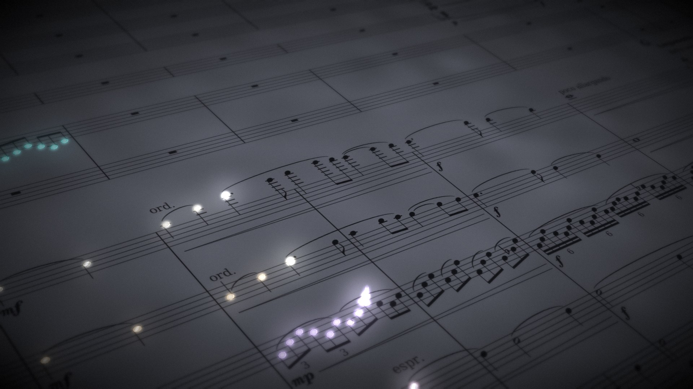

# Movement II glowing-score video

A second video style for movement II, made to match a screen recording Dan shared (the look of animated-score channels on YouTube). The whole movement is engraved on one long line and shown as a dark sheet seen at an angle by a slowly moving camera. Each note lights up in its part's colour while it sounds, and a light for each part jumps through the air from note to note. The audio is the same REAPER mockup the first video uses (`symphony/video/mvt2/`).



## Rebuild

```
apt-get install -y lilypond ffmpeg      # LilyPond 2.24
pip install numpy pillow opencv-python cairosvg
symphony/video/mvt2-glow/make-glow-video.sh --bars 53 64    # excerpt, about 10 min
symphony/video/mvt2-glow/make-glow-video.sh                 # whole movement, about 90 min on 4 cores
symphony/video/mvt2-glow/make-glow-video.sh --still 212     # test frames (video seconds), no MP4
```

The first run engraves the strip into `build/`, which takes about a minute. Later runs reuse it; delete `build/` after changing the score or `tools/make_strip_ly.py`. The MP4 goes to `mvt2-glow-video.mp4` (or `OUT=`) and is not committed. Inputs are the same as the first video: score `symphony/mvt2/v77`, audio and tempo map in `symphony/mvt2/reaper-export/` (override with `SCORE=` and `EXPORT=`).

## How it works

1. **`tools/build-strip.sh`** copies the version's sections and runs **`tools/make_strip_ly.py`**, which sets `ly:one-line-breaking` so the whole movement is one system, keeps every staff (no `\RemoveEmptyStaves`), and adds SVG `output-attributes` to noteheads (score moment `data-m` and duration `data-d` in quarter notes) and staff lines (staff name). LilyPond writes `strip.svg`. cairosvg then renders `strip2.png` **from that same SVG**. An earlier attempt engraved the PNG in a separate LilyPond run, and its line width differed slightly, so the lights missed the noteheads.
2. **`tools/glow_video.py`** reads note positions from the SVG and renders 1920×1080 frames at 30 fps into ffmpeg (H.264 CRF 17, AAC 320k):
   - **Time:** the `parts.json` tempo map converts score quarter notes to seconds. Audio 0:00 is qn 0.
   - **Sheet:** ink on a dark blue-grey paper (`PAPER`) with slight texture. Light falls off away from the playing area, the sheet blurs with distance (depth of field), and there is a vignette.
   - **Camera:** a 3D pinhole camera behind and to the left of the playhead, looking along the line (`CAM` az 45°, el 38°, roll 12°, distance 1450, focal 2600; override with `CAM='{"az":40}'`). It drifts slowly and follows the featured staves in `tools/features.py`. The sheet is mapped with a homography, and the jumping lights are projected with the same camera so they sit in 3D above the paper.
   - **Notes:** each note gets a core about the size of its notehead (0.62 × 0.48 staff spaces, projected) and a white centre. Two halos are added: a tight one (σ 4.5 px) and a wide, faint one that tints the paper. Both pass through a soft limit so that overlapping halos of close notes do not add up to one white blob. Notes that are sounding brighten and dim with the loudness of the recording (RMS envelope). A thin ring spreads from each note as it starts. Finished notes stay faintly lit as a trail.
   - **Jumping lights:** for each part, up to three lights (one per chord voice) jump along a parabolic arc from each onset to the next, arriving as the next note starts. A light stays fully lit while it sits on a note. Before a real rest it lifts off and fades, then drops onto the next entry. Airborne lights leave a short motion trail and cast a pool of light on the paper below them.
   - Light film grain stops the dark gradients from banding. Keep it small (σ 1.0): at 2.2 the excerpt grew from 30 MB to 130 MB.

## Changes Dan asked for (2026-10-13/14)

| Pass | Dan's note | Change |
|---|---|---|
| 1 | Match the paper angle of his recording; the notes bounce through the air; the lights were not exactly on the notes | 3D camera tuned against frames of the recording; jumping lights added; PNG rendered from the same SVG |
| 2 | "much closer", but close notes blurred together | Notehead-sized cores, tighter halo, soft limit on summed glow |
| 3 | The lights faded on landing, then lit up again before the jump | Lights stay fully lit until they jump. Also added the loudness-driven glow, strike rings, motion trails and grain |

"ok that looks good" after pass 4 (excerpt bars 53–64).
