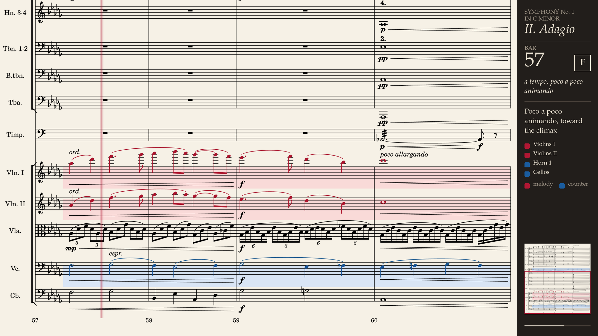

# Movement II score video

A YouTube-style score video: the engraved score of movement II plays in sync with the REAPER mockup (EastWest Hollywood Orchestra, cycle c26). The featured lines are highlighted because a full score does not fit a 16:9 screen.



## Rebuild

```
apt-get install -y lilypond ffmpeg      # LilyPond 2.24
pip install pillow numpy mido
symphony/video/mvt2/make-video.sh       # writes symphony/video/mvt2/mvt2-score-video.mp4
```

The render takes about 10 minutes on 4 cores. The MP4 (about 32 MB) is not committed.

Inputs, all in the repo:

| Input | Path | Why |
|---|---|---|
| Score | `symphony/mvt2/v77/` | The mockup was built from v77 (`reaper-export/README.txt`), so the video shows the notes that are heard. |
| Audio | `symphony/mvt2/reaper-export/mvt2-mockup-c26.mp3` | Final delivered master. 0:00 is score qn 0 (the pre-roll is cut). |
| Tempo | `symphony/mvt2/reaper-export/parts.json` | The `tempo` list (`[qn, bpm]` steps) is the tempo map REAPER played, with the rubato, ramps and caesuras. |

For a new mockup, set `SCORE=` and `EXPORT=` before running `make-video.sh`, and check `tools/features.py` against that version's bars.

## How it works

1. **`tools/make_video_ly.py`** turns the version's `score.ly` into `video.ly`:
   - short systems (3–4 bars, the `BREAKS` in `features.py`), staff size 18 on a 280 mm line, one system per page, empty staves hidden (including in the first system);
   - featured lines coloured in the engraving: red for the melody, blue for a counter-melody, per staff and bar range from `FEATURES`;
   - SVG `output-attributes` on noteheads, rests, bar lines (score moment in quarter notes) and staff lines (staff name).
2. **`tools/build.sh`** engraves `video.ly` twice with identical layout: once as SVG to read positions, once as 305 dpi PNG for the pictures. It also patches one tie callback in v77's `intro.ily` that fails when a system break falls inside the tie.
3. **`tools/parse_layout.py`** reads the SVGs into `build/layout.json`: per system, each staff's line positions, the x of every note column with its qn, and the bar lines, all in PNG pixels.
4. **`tools/render_video.py`** renders 1920×1080 frames at 30 fps and pipes them to ffmpeg (H.264 CRF 16, AAC 320k):
   - converts time to qn with the `parts.json` tempo map;
   - draws a playhead interpolated between note columns and tinted bands behind the featured staves (stronger in the bars where they play);
   - when a system is taller than the screen, pans vertically to keep the featured lines in view, looking 0.8 s ahead, with a minimap of the whole system;
   - crossfades to the next system just before its first beat;
   - side panel: bar number, rehearsal letter, tempo marking, a caption and the featured instruments;
   - adds a 4 s title card before the audio and a fade at the end.

To check a few frames without rendering the whole video:

```
python3 tools/render_video.py --build tools/build --tempo <parts.json> --audio <mp3> --out still --still 30 215 240
```

The `--still` times are video seconds; the music starts at 4 s. `--offset S` shifts the score against the audio.

## Sync check

With the c26 master, the loud attacks at bars 7, 23, 37, 53, 61, 63 and 79 all land within 0.05 s of the times the tempo map predicts, so no offset is needed.
